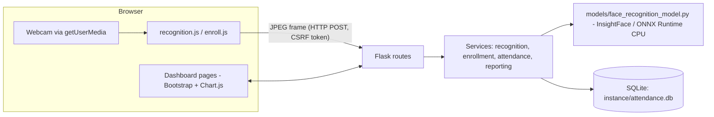
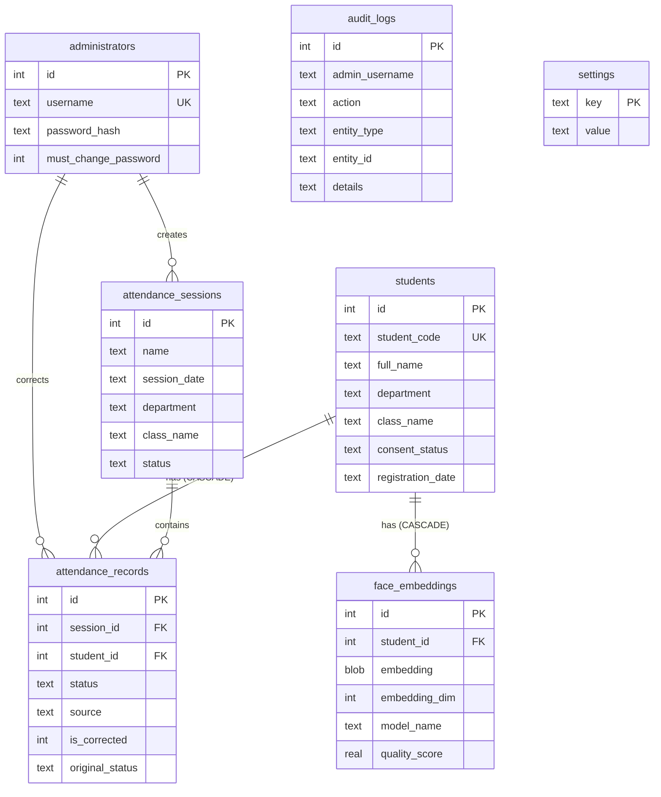

# System Architecture and Database Design

## 1. Architecture overview



Why the camera runs in the browser: it works the same on any laptop, needs no OpenCV GUI window, keeps the web
dashboard and live view on one page, and the browser asks the user for camera permission. Frames are sent to the
local Flask server (`127.0.0.1`), analysed in memory and discarded. `facialprogram.py` offers the same pipeline in an OpenCV window.

Layers: **routes** (HTTP, validation of request shape) -> **services** (all business rules) -> **database / model** (storage, AI).
Only `models/face_recognition_model.py` imports InsightFace, so the AI model can be replaced or mocked without touching other code.

## 2. AI pipeline (what is pretrained AI, what is ordinary logic)

```
Webcam frame
 -> Face detection            [PRETRAINED AI]  SCRFD-family detector in InsightFace pack "buffalo_s": boxes + 5 landmarks
 -> Face alignment            [classical maths] similarity transform from the landmarks to a standard 112x112 face
 -> Embedding extraction      [PRETRAINED AI]  MobileFaceNet-style network -> 512 numbers, L2-normalised
 -> Similarity calculation    [maths]  cosine similarity = dot product with every enrolled template
 -> Threshold + margin        [application logic]  score >= threshold AND beats 2nd-best person by `min_margin`
 -> Multi-frame confirmation  [application logic]  same person in N consecutive frames (default 2)
 -> Attendance validation     [application logic]  session open? person in scope? record already exists?
 -> Database insertion        [application logic]  INSERT guarded by UNIQUE(session_id, student_id)
 -> Dashboard update          [application logic]  charts poll /api/dashboard every 20 s
```

Definitions (for the viva):
* **Face detection** - finds *where* faces are. It does not know *who* they are.
* **Face recognition** - decides *who* a detected face is, by comparing it with enrolled people.
* **Embedding** - a vector of 512 numbers describing a face; images of the same person land close together.
* **Similarity score** - here cosine similarity: 1 = same direction, about 0 = unrelated. Not a probability.
* **Threshold** - the score above which we accept a match. Lower = more false accepts, higher = more false rejects. It must be tuned on your own data; it is configurable in the UI.

## 3. Database design (SQLite, normalised)



Key constraints
| Constraint | Purpose |
|---|---|
| `students.student_code UNIQUE` | one ID per person |
| `attendance_records UNIQUE(session_id, student_id)` | **duplicate attendance impossible, even with concurrent requests** |
| partial unique index `one_open_session ON attendance_sessions(status) WHERE status='open'` | only one open session |
| `face_embeddings.student_id ... ON DELETE CASCADE` | deleting a person cannot leave biometric data behind |
| `CHECK` constraints on status / source / consent | invalid values are rejected by the database |
| indexes on student_id, session_date, (department, class_name), audit created_at | fast filters and reports |

"Absent" is **derived**, not stored: a person is *expected* in a session if registered on/before the session date and inside the
session's department/class scope; no Present record = Absent. One SQL query (`attendance_service.MATRIX_SQL`) produces the
(session x expected person) table used by the attendance page, dashboard and every report, so all numbers agree.

### How embeddings are handled
* **Serialisation:** raw little-endian `float32` bytes in a BLOB (512 x 4 = 2048 bytes) plus `embedding_dim` and `model_name`. No text/JSON.
* **Access:** only server code reads them; they are never returned by any API and never placed under `static/`.
* **Model change:** templates carry `model_name`; recognition only loads templates of the active model, so a model switch cannot silently mix incompatible vectors (people must be re-enrolled).
* **Update:** re-enrollment replaces all of a person's templates in one transaction.
* **Delete:** *Delete face data* removes all templates and marks consent withdrawn; *Delete person* cascades. SQLite `secure_delete=ON` overwrites freed pages.
* **Not done (future work):** encryption at rest (e.g. SQLCipher or file-level encryption).

## 4. Security controls
| Threat | Control |
|---|---|
| Plain-text passwords | PBKDF2-SHA256 (600 000 iterations) with per-password salt |
| Brute force | lock-out after 5 failures per username+IP for 5 min; same message for unknown user / wrong password; dummy hash for equal timing |
| Session theft / fixation | HttpOnly + SameSite=Lax cookie, session cleared on login, 2 h inactivity expiry |
| CSRF | per-session token required on every POST (form field or `X-CSRF-Token`) |
| SQL injection | parameterised queries everywhere |
| XSS | Jinja auto-escaping, no inline scripts, Content-Security-Policy `script-src 'self'`, JS uses `escapeHtml` |
| Clickjacking / sniffing | `X-Frame-Options: DENY`, `frame-ancestors 'none'`, `nosniff` |
| Open redirect | `next` accepts local paths only |
| CSV/Excel formula injection | text cells starting with `= + - @` are prefixed with `'` in exports |
| Oversized uploads | 25 MB request limit, max 10 images, images shrunk to 1280 px |
| Public exposure of data | database and secret key live in `instance/`, outside static; default-admin password change is forced |

## 5. Timezone
All timestamps are stored as UTC ISO-8601. `config.TIMEZONE` (default `Asia/Karachi`, change with `APP_TIMEZONE`) is used for the
session date, every displayed time and every export (column header and Excel *Summary* sheet state the zone).
